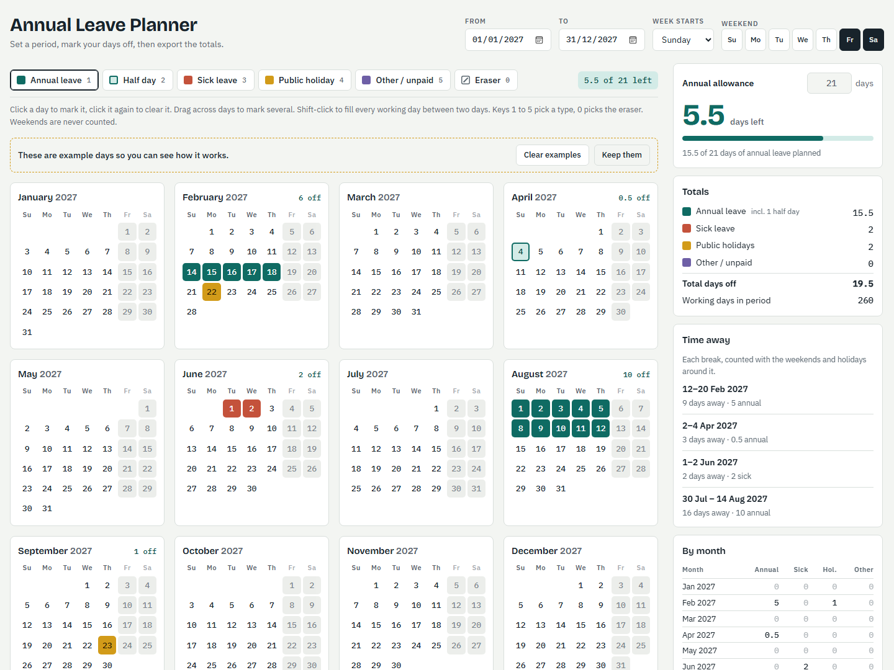
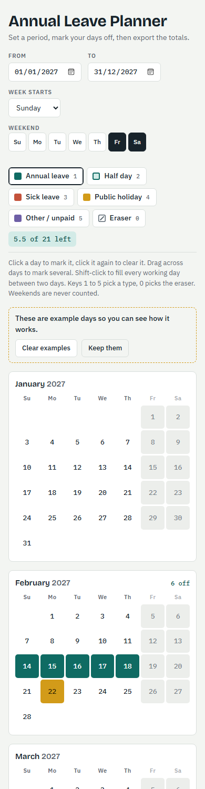

<div align="center">

# Annual Leave Planner

**See your whole year at once, mark your days off, and know exactly how much leave you have left.**

One HTML file, no sign-up, no server. Your plan never leaves your browser.

[](https://azaki9.github.io/annual-leave-planner/)
&nbsp;
[](LICENSE)
&nbsp;

&nbsp;


**[azaki9.github.io/annual-leave-planner](https://azaki9.github.io/annual-leave-planner/)**

<br>

<picture>
  <source media="(prefers-color-scheme: dark)" srcset="docs/screenshot-dark.png">
  
</picture>

</div>

---

## Why

Planning leave usually means a calendar in one tab, a spreadsheet in another, and counting on your fingers to work out whether that long weekend in March still fits.

This planner puts all of it on one screen. You pick the period, click the days you want off, and the totals update as you go: what you've used, what's left, how many days you'll actually be away, and how it splits month by month. When you're done, you download it as an Excel workbook with the summary on its own sheet, ready to attach to a leave request or send to your manager.

## Features

**Plan**
- **Any period you choose.** A calendar year, a fiscal year, the next six months, or up to 36 months at once.
- **Five kinds of day.** Annual leave, half day, sick leave, public holiday and other or unpaid, each in its own colour.
- **Fast marking.** Click a day, drag across a week, or shift-click two days to fill everything between them.
- **Your working week.** Pick your weekend days (Friday and Saturday by default, or any combination) and whether the week starts on Sunday, Monday or Saturday. Weekends are never charged.

**Count**
- **Allowance tracker.** Enter your entitlement and see how many days are left, with a warning when you go over.
- **Half days count as half.** Two half days use one day of allowance.
- **Time away.** Each break is shown with the weekends and holidays around it, so you can see that 5 days of leave gets you 9 days off.
- **Month by month.** A table of annual, sick, holiday and other days for every month in the period, with totals.

**Share**
- **Excel export** with four sheets: Summary, By month, Time away and Days.
- **CSV export** of every marked day, which you can load back in later.
- **Copy summary** as plain text, ready to paste into an email or chat.

**Everything else**
- **Saved automatically** in your browser, so it's still there when you come back.
- **Light and dark** themes that follow your system setting.
- **Works on a phone.** The layout stacks to one column on narrow screens.
- **Saudi national days in one click.** Founding Day (22 Feb) and National Day (23 Sep) for every year in your period.

## How the numbers work

| Rule | What it means |
|---|---|
| Only working days count | A weekend day can't be marked and is never charged against your allowance. |
| Annual leave uses allowance | Each annual day uses 1 day and each half day uses 0.5. Sick, holiday and other days are counted separately and don't touch your allowance. |
| Remaining | Your allowance minus annual leave and half days. Below zero, it shows how many days you're over. |
| Total days off | Annual, half, sick, holiday and other days, all on working days. |
| Days outside the period | Kept, but left out of every total until you widen the period again. |

### Time away

A break is any run of non-working days (weekends and public holidays) that has at least one day of leave in it. The planner counts the whole run, including the weekends before and after.

```
 Fri   Sat │ Sun   Mon   Tue   Wed   Thu │ Fri   Sat
  ·     ·  │  A     A     A     A     A  │  ·     ·
           │      5 days of annual leave  │
 └─────────────────── 9 days away ──────────────────┘
```

A public holiday next to your leave stretches the break for free. Mark one and watch the "days away" figure go up while your allowance stays the same.

## Using it

1. **Set the period.** Choose the From and To dates at the top right.
2. **Set your week.** Pick your weekend days and the day your week starts.
3. **Enter your allowance** in the summary panel.
4. **Pick a type** from the toolbar and **mark your days** on the calendar.
5. **Download** the Excel or CSV file, or copy the summary.

The planner opens with a few example days so you can see how it works. Click **Clear examples** to start from an empty calendar.

### Mouse and keyboard

| Action | How |
|---|---|
| Mark a day | Click it |
| Clear a day | Click it again with the same type, or use the eraser |
| Mark several days | Click and drag across them |
| Fill a range | Click the first day, then shift-click the last |
| Choose a type | <kbd>1</kbd> annual · <kbd>2</kbd> half day · <kbd>3</kbd> sick · <kbd>4</kbd> holiday · <kbd>5</kbd> other · <kbd>0</kbd> eraser |
| Mark with the keyboard | <kbd>Tab</kbd> to a day, then <kbd>Enter</kbd> or <kbd>Space</kbd> |

On a touchscreen, tap days one at a time. Dragging scrolls the page instead.

## What's in the export

**Excel (`leave-plan <from> to <to>.xlsx`)**

| Sheet | Columns |
|---|---|
| Summary | Period, weekend days, allowance, annual used, half days, remaining, sick, public holidays, other, total days off, working days in period |
| By month | Month, Annual, Sick, Public holiday, Other / unpaid, Total, with a totals row |
| Time away | From, To, Days away, Annual days, Sick days, Other days |
| Days | Date, Weekday, Type, Days counted, one row per marked day |

**CSV (`leave-plan <from> to <to>.csv`)** has the same columns as the Days sheet. It opens in Excel, Numbers or Google Sheets, and **Load a saved CSV** reads it back into the planner.

## Your data stays yours

- There's no account, no backend and no analytics.
- Your marks and settings are saved in your browser's local storage on your device and nowhere else.
- Exports are built in the page and saved straight to your computer.
- The only things the page loads from the internet are its fonts (Google Fonts) and the Excel library (SheetJS from cdnjs).

Local storage is cleared if you clear your browser data or use a private window. **Download the CSV to keep a copy you can load back later.**

## Run it yourself

It's one file, so there's nothing to install or build.

**Open it locally**

```bash
git clone https://github.com/Azaki9/annual-leave-planner.git
```

Then open `index.html` in any modern browser.

**Or serve it** (useful when testing on a phone on the same network)

```bash
cd annual-leave-planner
python -m http.server 8000
```

Then go to `http://localhost:8000`.

**Host your own copy on GitHub Pages**

1. Fork this repository.
2. In your fork, go to **Settings → Pages**.
3. Under **Build and deployment**, pick **Deploy from a branch**, then `main` and `/ (root)`.
4. Your copy is live at `https://<your-username>.github.io/annual-leave-planner/` within a minute or two.

## Make it yours

Everything lives in [`index.html`](index.html). The places you're most likely to change:

| To change | Look for |
|---|---|
| The default period, weekend, allowance or example days | `DEFAULTS` and `exampleMarks()` |
| Leave types, their names, or how much each counts | `TYPES` (a `units` of `0.5` makes a half day) |
| Colours and fonts | The `:root` block at the top of the `<style>` tag, with dark-mode values just below |
| The one-click national holidays | The `#addNational` click handler |
| The longest allowed period | `MAX_MONTHS` |

If you change `TYPES`, give each new type a colour in the CSS (`.sw.<type>` and `.day[data-t="<type>"]`) and a column in `compute()` and the export functions.

## Built with

- Plain HTML, CSS and JavaScript in a single file of about 800 lines. No framework and no build step.
- [SheetJS](https://sheetjs.com/) for the Excel workbook.
- [Bricolage Grotesque](https://fonts.google.com/specimen/Bricolage+Grotesque), [IBM Plex Sans](https://fonts.google.com/specimen/IBM+Plex+Sans) and [IBM Plex Mono](https://fonts.google.com/specimen/IBM+Plex+Mono) from Google Fonts.

Works in current versions of Chrome, Edge, Firefox and Safari, on desktop and mobile.

<div align="center">
  
</div>

## Ideas for later

- [ ] Carry over unused days from the previous year
- [ ] Export to a calendar file (`.ics`) for Outlook and Google Calendar
- [ ] Fill in Eid holidays from the Hijri calendar
- [ ] Several people on one page, for team planning
- [ ] A notes field on each break, such as "Family trip"

Have another idea or found a bug? [Open an issue](https://github.com/Azaki9/annual-leave-planner/issues).

## Contributing

Pull requests are welcome. Keep it to one file and no build step, test it in light and dark mode at phone width, and describe what changed in the pull request.

## License

[MIT](LICENSE) © 2026 Ahmed Zaki
